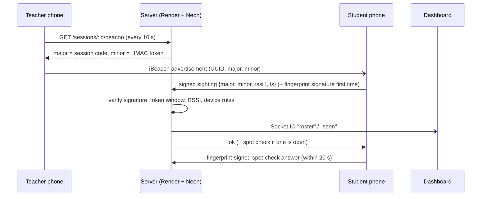

# ProxyProof

**Bluetooth attendance that can't be marked by a friend.**
The teacher's phone broadcasts a rotating Bluetooth beacon; students' phones hear it and are marked
present automatically. Rotating tokens, phone-bound hardware keys, fingerprint checks, signal-strength
rules and presence over the whole class make proxy attendance impractical.

| | |
|---|---|
| **Live dashboard** | https://proxyproof.onrender.com (free tier: first load after idle takes ~50 s) |
| **Android APK** | [Download ProxyProof.apk](https://github.com/chatrathhriday/ProxyProof/releases/latest/download/ProxyProof.apk) · [all releases](https://github.com/chatrathhriday/ProxyProof/releases) |
| **Demo video** | _link_ |
| **Demo logins** | teacher `prof@proxyproof.test` · admin `admin@proxyproof.test` · students `student1..3@proxyproof.test` — password `password123` |

---

## Teacher experience: 20 seconds per class

1. Open the app → tap **Start** next to the course. *(the phone starts broadcasting)*
2. Teach. Students are marked as they walk in; the count updates live on the phone and the web dashboard.
3. Tap **Close session**. The summary says e.g. **"42 present · 2 need review · 6 absent"**.
   Glance at the 2 flagged rows (each has a one-line reason), tap **Approve all**. Done.

The same summary, with **Approve all**, opens on the teacher's phone right after closing (and on the dashboard).
No roll call, no QR code on the projector, no PIN to read out. Everything else (thresholds, the 80% rule)
has sensible defaults and stays out of the way.

## Setting up (once per course)

Dashboard → **New course** (code + name) → paste students' emails (they register in the app first).
The course page then shows each student's attendance % and whether their phone is linked.
Admins add teacher accounts and approve phone changes from their dashboard page.

## Student experience

Tap **Continue with Google** with your **@vitstudent.ac.in** account — nothing else is accepted (the phone is then bound to that account), tap **Start attendance** when you sit down, touch the
fingerprint sensor once, **then lock the phone and put it away** — a foreground service (the small
"ProxyProof is taking attendance" notification) keeps scanning and reporting in the background.
A random spot check may buzz the phone once more; tap the notification and touch the sensor within 20 s.
The **My attendance** screen shows the percentage per course and a **"Can I bunk?"** calculator for the 75% rule.

---

## Sign-in: VIT Google accounts only

- The app gets a Google **ID token** and the server verifies it itself: Google's signature (published JWKS keys),
  `aud` = our OAuth client, issuer, expiry, `email_verified` and **`hd = vitstudent.ac.in`**. Google sets `hd` only for
  accounts that belong to that Workspace, so a look-alike personal Gmail can't pass.
- Password sign-up is switched off in production. Teachers/admins use accounts the admin creates;
  the seeded demo accounts keep passwords so evaluators can try every role.
- Teachers can add students' emails before they ever sign in — those become **invites** and turn into
  enrolments automatically on the student's first Google sign-in.

## How it works



### 1. Rotating BLE token (iBeacon)
- Standard **iBeacon** frame (Apple company id `0x004C`), so Android *and* iPhones can detect it.
- Fixed app UUID `b55d5a77-aef8-4366-832a-9747001afeeb`; **major** = random 16-bit session code;
  **minor** = `first 16 bits of HMAC-SHA256(session_secret, floor(unix_time / 10))`.
- The secret never leaves the server. The teacher's phone only ever receives the current 16-bit token,
  so even a compromised teacher phone can't produce future tokens.
- The server accepts the current 10 s window **±1** (clock skew + scan latency) — a screenshotted or
  relayed token is dead within ~30 s.
- 16 bits is guessable, so attempts are **rate-limited per device and per account** (10/min):
  ~5 guesses per 30 s, each with 3/65,536 odds (3 windows are valid at once) → ~1 in 4,400.

### 2. Device binding (Android Keystore)
On first login the app creates **two EC P-256 keys inside the Android Keystore** (StrongBox chip when
available). Private keys can never be exported from secure hardware.

| Key | Unlocked by | Signs | Proves |
|---|---|---|---|
| **Device key** | nothing (silent) | every request | *this exact phone* |
| **Fingerprint key** | `BIOMETRIC_STRONG`, **every use**; **invalidated when a new fingerprint is enrolled** | first mark in each class, spot checks | *the enrolled owner is holding it* |

- Why two keys: one biometric-per-use key would prompt every 10 s.
- Why not `local_auth`: it only returns "fingerprint OK: true/false", which a patched app can fake.
  Here the fingerprint unlocks a key; no fingerprint → no valid signature → server rejects.
- No PIN fallback on purpose: a PIN can be shared, a fingerprint can't.
- The server stores both public keys. `device_uid = sha256(device public key)`, so the id can't be forged.
- **First phone is approved automatically. Any other phone — or the same phone after biometrics change
  (keys destroyed → new keys) — is "pending" until an admin approves it.** Approving retires the old phone.
- A phone already bound to student A cannot be registered by student B.

### 3. Signed, replay-proof requests
The phone signs the **exact JSON string** it sends (`payload`) and the server verifies those bytes before
parsing — no canonical-JSON ambiguity between Dart and Node. Every payload carries a timestamp that must
be within 60 s of server time and strictly greater than the last one seen from that device.

### 4. Marking rules (server)
A sighting is accepted only if **all** hold:
1. rate limit not exceeded, 2. request signed by the student's **approved device**, 3. fresh & not replayed,
4. session active, 5. student **enrolled**, 6. BLE token in the current window ±1,
7. **median RSSI** over the recent samples ≥ threshold (default −75 dBm; median ignores one-off spikes),
8. **one device marks one student per session** (and a student can't switch phones mid-class),
9. the first mark carries a valid **fingerprint-key** signature.

### 5. Presence over the whole class
- Phones report every ~10 s. The class is cut into **30 s buckets**; *in range %* = buckets with at least
  one accepted sighting.
- **One automatic spot check** at a random time (20–70% into the expected class length) + a
  **"Spot check now"** button. A student's phone gets it in its next reply and has **20 s** to answer with a
  fingerprint signature. Out of range when it opens? A **make-up check** is delivered if they come back within
  **2 minutes**.
- **Verdict** (clear cases resolve themselves, only unclear ones are flagged):

| Situation | Verdict |
|---|---|
| never detected | **absent** |
| in range < 25% of the class | **absent** |
| didn't answer / missed a spot check | **needs review** |
| in range ≥ 80% (configurable) | **present** |
| anything in between | **needs review** |
| teacher marked manually | teacher's decision |

### 6. Student history & "Can I bunk?"
With **A** classes attended out of **T** held and the 75% rule:
- can still skip **k = ⌊4A/3 − T⌋** classes (largest k with A/(T+k) ≥ 0.75)
- or must attend the next **m = ⌈3T − 4A⌉** in a row (smallest m with (A+m)/(T+m) ≥ 0.75)

Cases pending review are **not** counted as attended — the safe choice for someone deciding whether to skip.

---

## Threat model

| # | Attack | Defence | Residual risk |
|---|---|---|---|
| 0 | Fake student account (made-up email) | Accounts are created only from Google ID tokens with a verified `@vitstudent.ac.in` hosted domain | A real VIT student lending their Google login — still blocked by device binding + fingerprint (rows 1–3) |
| 1 | Friend marks me from his phone with my password | Requests must be signed by **my approved phone's** Keystore key; a new phone needs admin approval | Admin approves a malicious request without checking |
| 2 | I hand my phone to a friend in class | First mark + spot checks need **my fingerprint** (hardware-enforced); one phone = one student per session | Friend gets my fingerprint on purpose (collusion with my finger present = I'm present) |
| 3 | Friend adds his fingerprint to my phone | Keystore **invalidates the fingerprint key** on new enrolment → new keys → treated as a new phone → admin approval | — |
| 4 | Photo/screenshot/relay of the beacon to someone at home | Token rotates every 10 s, valid ~30 s; relay must be live **and** be heard with strong RSSI | Real-time BLE relay hardware next to the beacon + remote phone (high effort; spot check still needs the owner's finger at the remote phone) |
| 5 | Guess the 16-bit token | Rate limit 10/min per device and per account | ~1 in 4,400 per 30 s; repeated tries are logged-in, device-bound and rate-limited |
| 6 | Tampered app sends fake RSSI / marks without hearing the beacon | Must still present the **current token** (only obtainable by hearing the beacon); RSSI median + whole-class presence + random spot check | A modified app *near* the beacon can claim strong RSSI — but then the student is in the room |
| 7 | Mark in, then leave | Presence timeline: < 80% in range → review, < 25% → absent; spot check catches leavers | Leaving after the last report of a bucket costs < 30 s accuracy |
| 8 | Replay a captured request | Signed timestamp, ±60 s skew, strictly increasing per device | — |
| 9 | Clone the app's keys to another phone | Keys are non-exportable (TEE/StrongBox) | Rooted phone with a broken TEE (out of scope; Play Integrity / key attestation would be the next step) |
| 10 | Malicious teacher device / stolen teacher login | Teacher phone never holds the secret; sessions & roster scoped to the owning organiser; JWT required for sockets | Stolen teacher password can start sessions (add 2FA in production) |
| 11 | CSV formula injection via a student's name (`=HYPERLINK(…)`) | Cells beginning with `= + - @` are prefixed with `'` | — |

## iOS notes

- **Detection works today**: the beacon is a standard iBeacon, which iOS Core Location ranges natively
  (`CLLocationManager` with our UUID) — even more efficiently than Android.
- **Broadcasting from an iPhone works in the foreground** (`CBPeripheralManager` with an iBeacon
  advertisement); iOS stops custom advertising in the background, so the teacher keeps the screen open
  (same as on Android).
- **Device binding** maps to the **Secure Enclave**: `SecKeyCreateRandomKey` with
  `kSecAttrTokenIDSecureEnclave` and access control `.biometryCurrentSet` — the iOS equivalent of
  "invalidated when new biometrics are enrolled". The server side is unchanged (P-256 ECDSA, SPKI public keys).
- Background scanning: iOS region monitoring wakes the app on entering a beacon region, so students
  wouldn't even need to open it.
- **Current status:** the Android app is the shipped product. An iPhone build needs (a) a Swift version of
  `DeviceKeys.kt` using the Secure Enclave, (b) iOS location/Bluetooth permission strings and background modes,
  (c) a Mac/Xcode (or a macOS CI runner) to build, and (d) an Apple Developer account ($99/yr) to install via
  TestFlight. A web page can't replace it: Safari on iPhone has no Bluetooth access. The server, dashboard and
  all Flutter screens are already platform-neutral, so (a)–(d) are the whole port.

---

## Architecture

```
app/        Flutter (Android first): broadcast, scan, Keystore keys (Kotlin), history
backend/    Node.js + Express + PostgreSQL + Socket.IO
dashboard/  React (Vite) organiser dashboard, built and served by the backend
tools/      laptop_beacon.py / laptop_student.py — test BLE with a single phone
render.yaml one-click Render deploy (Neon Postgres via DATABASE_URL)
```

**Why these choices**
- **One server for API + dashboard + websockets**: one deploy, one URL, no CORS.
- **PGlite** (Postgres compiled to WASM) for local dev/tests: same SQL as production, nothing to install.
- **Server decides everything** (RSSI median, windows, verdicts): the phone is untrusted.
- **Socket.IO rooms per session** with an ownership check; "seen" events patch one row, "roster" events refetch.
- **Shared clock module** lets tests fast-forward a whole 10-minute class with spot checks in milliseconds.

## Run it locally

```bash
# backend (embedded Postgres, no setup)
cd backend && npm install && npm run seed && npm run dev      # http://localhost:3000
# dashboard (dev server with API proxy) — or `npm run build` and the backend serves it
cd dashboard && npm install && npm run dev
# tests
cd backend && npm test        # 15 integration tests incl. a simulated class
cd app && flutter test        # bunk-calculator unit tests
# app on a phone over USB
cd app && flutter run         # then: adb reverse tcp:3000 tcp:3000
```

Release APK: built by GitHub Actions (`.github/workflows/apk.yml`) and attached to Releases on `v*` tags.

## Known limitations / next steps
- Background attendance stops if the student swipes the app away (the foreground service is tied to the app's task);
  some phones also need "battery optimisation" turned off for the app, which it asks for on first start.
- Single Render instance: the rate limiter is in memory (Redis for multiple instances).
- Key attestation / Play Integrity would prove keys really live in hardware on unrooted devices.
- Demo accounts and passwords are seeded on purpose; disable `SEED_DEMO` for real use.
